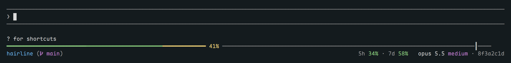
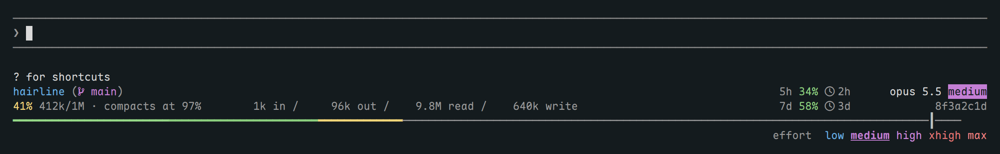

# hairline



Hairline is a Claude Code mod and a [Pi](https://pi.dev) extension that adds a status line under the prompt. In the terminal it is two rows of four columns over a context bar that spans the terminal. The rows show the repository with the worktree and the branch, the context use with its auto-compact mark, the activity: output tokens per second, eased every 400 ms, over a filled graph that moves every frame; while a request waits, "waiting", the seconds in white and a blue mark that runs along a dim track; while tools run, their count and each name and argument. Under it the token split: input, output, cache read and cache write in one muted gray, joined by `/`. Then 5h and 7d limits, and the month's extra usage spend against its cap while extra usage is on and the 5h or 7d limit is at 95% or more. The spend comes from claude.ai's undocumented usage endpoint once a minute, with a Claude subscription login only; when that call fails, or with `CLAUDE_CODE_DISABLE_NONESSENTIAL_TRAFFIC` set, the figure stays hidden. While idle the line reads the account's 5h and 7d use from the same endpoint once a minute, so other sessions' use shows too. Click the token split for cost, cache use, subagent share and how fast each limit fills. Click the model or effort to pick another, and click the session ID to copy it. Hairline takes its colors from your terminal's own palette. Hairline is tested on Claude Code 2.1.312 in the terminal. In the Claude desktop app it draws in the band above the prompt, without the folder, branch, model and effort that the app shows already. The idle mark is a white circle everywhere. In the terminal the tool glyph comes from a Nerd Font when one is installed; without one, its place stays blank. Hairline looks for one only once and keeps the answer. After you install or remove a Nerd Font, run `/hairline-fonts` to look again. The desktop app shows an emoji for it.




## Install

```sh
claude plugin marketplace add accodev/hairline
claude plugin install hairline@hairline
```

Run `/reload-plugins` in an open session to load it.

## Pi

```sh
pi install git:github.com/accodev/hairline
```

Run `/reload` in an open session to load it. In Pi, hairline replaces the footer and keeps other extensions' status texts on a line below it. In Pi's fullscreen mode (`tuiMode`, the default) the line takes the same clicks as in Claude Code: the token split opens the panel, the model and the thinking level open pickers, and the session ID copies itself. The part under the pointer is underlined. Pi's regular mode leaves the mouse to the terminal, so commands stand in for the clicks there:

| Command | Effect |
|---|---|
| `/hairline` | Shows or hides the ledger. |
| `/hairline-id` | Copies the session ID. |
| `/hairline-fonts` | Looks for a Nerd Font again. |

The model picker offers the session's scoped models, or every model with a key. Pi's thinking level takes the place of effort. Pi's own `/model`, `Ctrl+P` and `Shift+Tab` still work. The speed shows from the first streamed chunk, without Claude Code's 1 second warm-up. The 5h and 7d limits come from the headers of Anthropic subscription responses, so other providers show none. The extra usage spend needs Pi's Anthropic login through `/login`; an Anthropic API key has none. The context bar marks where `compaction.reserveTokens` starts auto-compaction. The ledger has no subagent share, because Pi subagents run as separate sessions. Hairline keeps the font answer, the last limits and each session's turn time in `~/.pi/agent/hairline.json`. Pi's `settings.json` takes the options below under a `hairline` key, for example `"hairline": { "currency": "USD" }`.

## Settings

Claude Code keeps them in `settings.json`, under `pluginConfigs["hairline@hairline"].options`.

| Option | Default | Effect |
|---|---|---|
| `layout` | `scan` | `scan`: the context bar over one row, with the workspace left and the limits and the model right. While Claude works, a light runs along the bar: orange in Claude's thinking color while it thinks, green while it writes, as fast as the tokens arrive, amber while a tool runs. `middle`: the same bar and row, the activity centered between them in words: thinking and its seconds, tokens per second and a dot line, the running tool. `columns`: two rows of four columns over the bar. In `scan` and `middle` the percent sits on the bar where the fill ends, and a click on the limits opens the ledger. |
| `currency` | `EUR` | `USD`, `CAD`, `AUD`, `EUR`, `JPY` or `CNY`. |
| `usdRate` | `0.9` | Value of 1 US dollar in that currency, used when the exchange rate cannot be fetched. |
| `cacheTtlMinutes` | `60` | Prompt cache lifetime, 60 or 5 as your plan uses. |
| `speedRefreshPerSecond` | `30` | Updates of the tokens per second figure, 1 to 30. |
| `animationFps` | `30` | Frames per second of the graph, 1 to 60. |

## Development

```sh
claude plugin validate .
claude plugin test .
```

```sh
npm ci
npm run typecheck:pi
npm run test:pi
```

Those check the Pi extension in `pi/`. CI runs all five commands on every push to `main` and on pull requests. On `main` it also renders the README images from `tests/screenshots.test.ts` and pushes them to the `screenshots` branch.

```sh
node scripts/screenshots.mjs out
```

That renders them locally, with Chrome or Edge.
