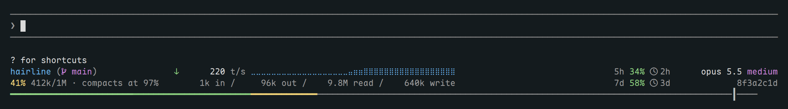
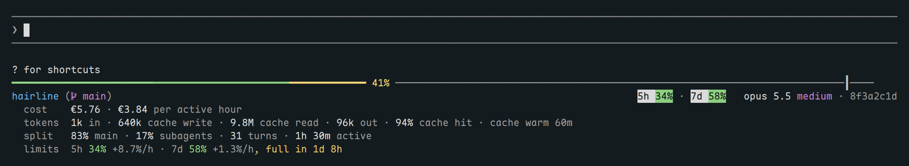

# hairline

[](https://www.npmjs.com/package/@accodev/hairline)
[](https://www.npmjs.com/package/@accodev/hairline)
[](https://github.com/accodev/hairline/actions/workflows/ci.yml)
[](https://github.com/accodev/hairline/actions/workflows/e2e.yml)
[](https://scorecard.dev/viewer/?uri=github.com/accodev/hairline)
[](LICENSE)

hairline adds a status line under the prompt: a context bar over one row of facts about the session. It works in Claude Code and in [Pi](https://pi.dev).


## How it works

The context bar spans the terminal and fills with the context use. The percent sits where the fill ends, and a mark shows where auto-compaction starts.

The row under it shows the repository, the worktree and the branch on the left. The 5h and 7d limits, the model, the effort and the session ID sit on the right.

While idle, hairline reads the account's 5h and 7d use once a minute, so other sessions' use shows too. The colors come from your terminal's own palette.

## Layouts

The `layout` setting picks how the line shows what Claude is doing.

`scan` is the default. A light runs along the context bar while Claude works: orange while it thinks, green while it writes, amber while a tool runs. The green light moves as fast as the tokens arrive.



`middle` keeps the bar still and puts the activity in words in the middle of the row. It shows the seconds spent thinking, the tokens per second with a dot line, or the running tool.

## Clicks

| Part | Click |
|---|---|
| 5h or 7d limit | Opens the ledger. |
| Token total | Opens the ledger, where there are no limits. |
| Model | Opens the model picker. |
| Effort | Opens the effort picker. |
| Session ID | Copies the session ID. |

The ledger lists the cost, the token split, the cache use, the subagent share and how fast each limit fills.



The pickers list the choices under the line. A click on one applies it.


## Extra usage

After the limits, hairline shows the month's extra usage spend against its cap. It shows only while extra usage is on and the 5h or 7d limit is at 95% or more.

The spend comes from claude.ai's undocumented usage endpoint once a minute, with a Claude subscription login only. When that call fails, or with `CLAUDE_CODE_DISABLE_NONESSENTIAL_TRAFFIC` set, the figure stays hidden.

## Install

### Claude Code

```sh
claude plugin marketplace add accodev/hairline
claude plugin install hairline@hairline
```

Run `/reload-plugins` in an open session to load it. hairline is tested on Claude Code 2.1.312.

### Pi

```sh
pi install npm:@accodev/hairline
```

Run `/reload` in an open session to load it. hairline replaces Pi's footer and keeps other extensions' status texts on a line below it.

In Pi's fullscreen mode, the default `tuiMode`, the line takes the same clicks as in Claude Code. The part under the pointer is underlined. Pi's regular mode leaves the mouse to the terminal, so commands stand in for the clicks:

| Command | Effect |
|---|---|
| `/hairline` | Shows or hides the ledger. |
| `/hairline-id` | Copies the session ID. |
| `/hairline-fonts` | Looks for a Nerd Font again. |

The model picker offers the session's scoped models, or every model with a key. Pi's thinking level takes the place of effort, and Pi's own `/model`, `Ctrl+P` and `Shift+Tab` still work.

The 5h and 7d limits come from the headers of Anthropic subscription responses, so other providers show none. The extra usage spend needs Pi's Anthropic login through `/login`.

The speed shows from the first streamed chunk. The ledger has no subagent share, because Pi subagents run as separate sessions. hairline keeps its own state in `~/.pi/agent/hairline.json`.

## Settings

Claude Code keeps them in `settings.json`, under `pluginConfigs["hairline@hairline"].options`. Pi takes them in its `settings.json` under a `hairline` key, for example `"hairline": { "currency": "USD" }`.

| Option | Default | Effect |
|---|---|---|
| `layout` | `scan` | `scan` or `middle`. See [Layouts](#layouts). |
| `currency` | `EUR` | `USD`, `CAD`, `AUD`, `EUR`, `JPY` or `CNY`. |
| `usdRate` | `0.9` | Value of 1 US dollar in that currency, when the exchange rate cannot be fetched. |
| `cacheTtlMinutes` | `60` | Prompt cache lifetime: 60 or 5, as your plan uses. |
| `speedRefreshPerSecond` | `30` | Updates of the tokens per second figure, 1 to 30. |
| `animationFps` | `0` | Frames per second of the scan and the dot line, 1 to 240. `0` matches the display's refresh rate, or 60 when the system does not report it. |

## Fonts and the desktop app

In the terminal, the tool glyph comes from a Nerd Font when one is installed. Without one, its place stays blank. hairline looks for a font once and keeps the answer, so run `/hairline-fonts` after you install or remove one.

In the Claude desktop app, hairline draws in the band above the prompt. It leaves out the folder, the branch, the model and the effort, which the app shows already. The tool glyph is an emoji there.

## Development

```sh
claude plugin validate .
claude plugin test .
```

Those check the Claude Code mod in `claude/`.

```sh
npm ci
npm run typecheck:pi
npm run test:pi
```

Those check the Pi extension in `pi/`. CI runs all five commands on every push to `main` and on pull requests.

```sh
node --experimental-strip-types scripts/screenshots.ts out
```

That renders the README images locally, with Chrome or Edge. On `main`, CI renders them from `tests/screenshots.test.ts` and pushes them to the `screenshots` branch.
