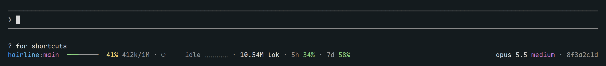
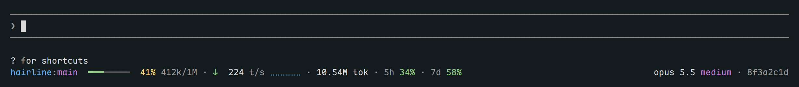
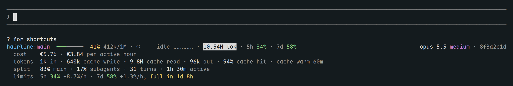
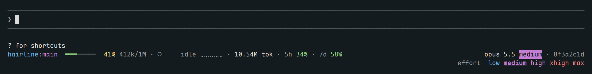

# hairline



Hairline is a Claude Code mod that adds one status line under the prompt. The line shows folder and branch, a context bar with an auto-compact mark, output tokens per second (between replies, the phase: idle, sending or running), session tokens, and 5h and 7d limits. Click the token count for cost, cache use, subagent share and how fast each limit fills. Click the model or effort to pick another, and click the session ID to copy it. Hairline takes its colors from your terminal's own palette. Hairline is tested on Claude Code 2.1.312 in the terminal. In the Claude desktop app it draws in the band above the prompt, without the folder, branch, model and effort that the app shows already. The idle mark is a white circle everywhere. In the terminal the tool glyph comes from a Nerd Font when one is installed; without one, its place stays blank. Hairline looks for one only once and keeps the answer. After you install or remove a Nerd Font, run `/hairline-fonts` to look again. The desktop app shows an emoji for it.







## Install

```sh
claude plugin marketplace add accodev/hairline
claude plugin install hairline@hairline
```

Run `/reload-plugins` in an open session to load it.

## Settings

Claude Code keeps them in `settings.json`, under `pluginConfigs["hairline@hairline"].options`.

| Option | Default | Effect |
|---|---|---|
| `currency` | `EUR` | `USD`, `CAD`, `AUD`, `EUR`, `JPY` or `CNY`. |
| `usdRate` | `0.9` | Value of 1 US dollar in that currency, used when the exchange rate cannot be fetched. |
| `cacheTtlMinutes` | `60` | Prompt cache lifetime, 60 or 5 as your plan uses. |
| `speedRefreshPerSecond` | `30` | Updates of the tokens per second figure, 1 to 30. |
| `animationFps` | `30` | Frames per second of the speed dot line, 1 to 60. |

## Development

```sh
claude plugin validate .
claude plugin test .
```

CI runs both commands on every push to `main` and on pull requests. On `main` it also renders the README images from `tests/screenshots.test.ts` and pushes them to the `screenshots` branch.

```sh
node scripts/screenshots.mjs out
```

That renders them locally, with Chrome or Edge.
