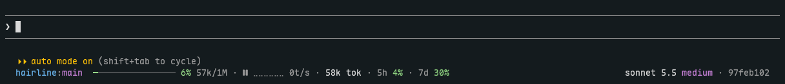
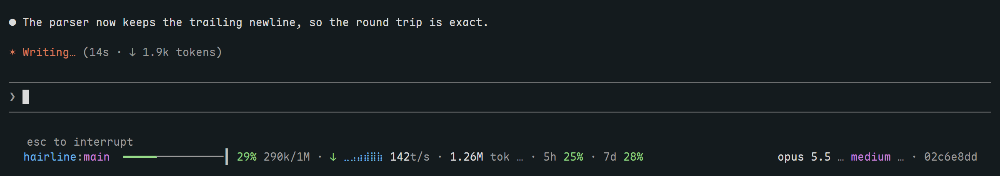
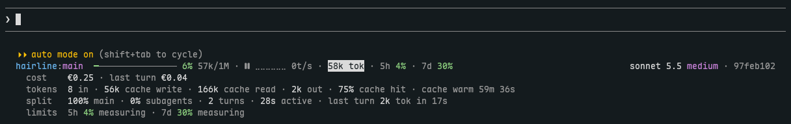
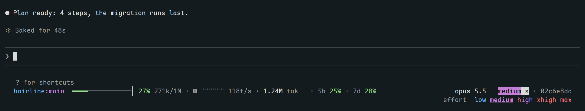

# hairline



Hairline is a Claude Code mod that adds one status line under the prompt. The line shows folder and branch, a context bar with an auto-compact mark, output tokens per second, session tokens, and 5h and 7d limits. Click the token count for cost, cache use, subagent share and how fast each limit fills. Click the model or effort to pick another, and click the session ID to copy it. Hairline takes its colors from your terminal's own palette. Hairline needs Claude Code mods (early access) and is tested on Claude Code 2.1.312 in the terminal. The Claude desktop app is not supported: its Code tab does not draw the `PromptHint` line.







## Install

```sh
claude plugin marketplace add accodev/hairline
claude plugin install hairline@hairline
```

Run `/reload-plugins` in an open session to load it.

## Settings

Claude Code keeps them in `settings.json`, under `pluginConfigs["hairline@hairline"].options`.

| Option | Default | Effect |
|---|---|---|
| `currency` | `USD` | ISO 4217 code for the cost figures. |
| `usdRate` | `1` | Value of 1 US dollar in that currency. |
| `cacheTtlMinutes` | `60` | Prompt cache lifetime, 60 or 5 as your plan uses. |
| `speedRefreshPerSecond` | `30` | Updates of the tokens per second figure, 1 to 30. |
| `animationFps` | `30` | Frames per second of the speed dot line, 1 to 60. |
| `nerdFont` | `false` | Nerd Font icons for the tool and idle phases. Off uses `↻` and `‖`. |

## Development

```sh
claude plugin validate .
claude plugin test .
```

CI runs both commands on every push to `main` and on pull requests.
